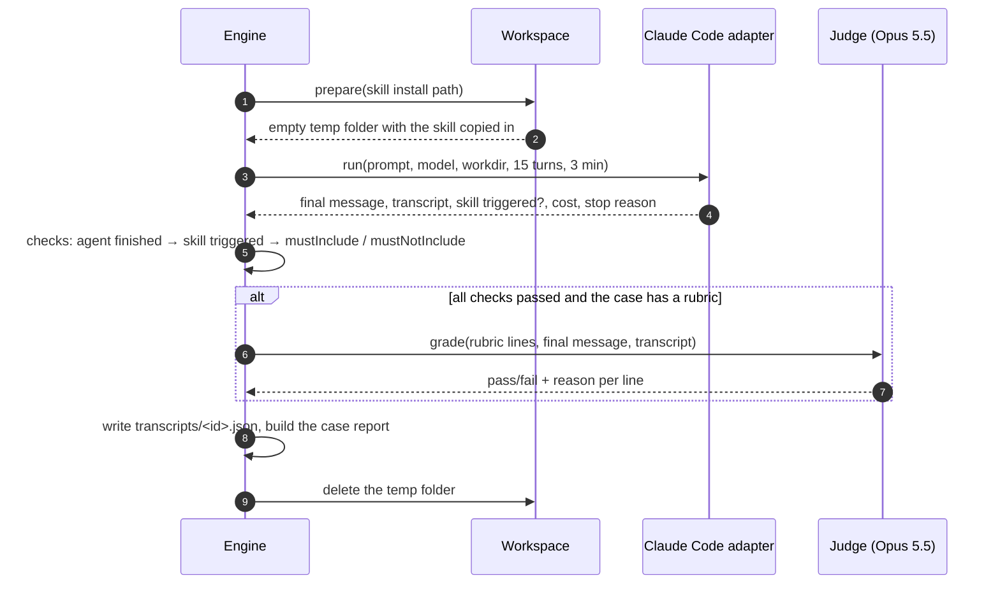
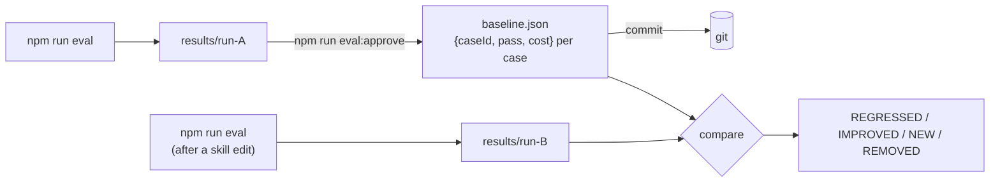
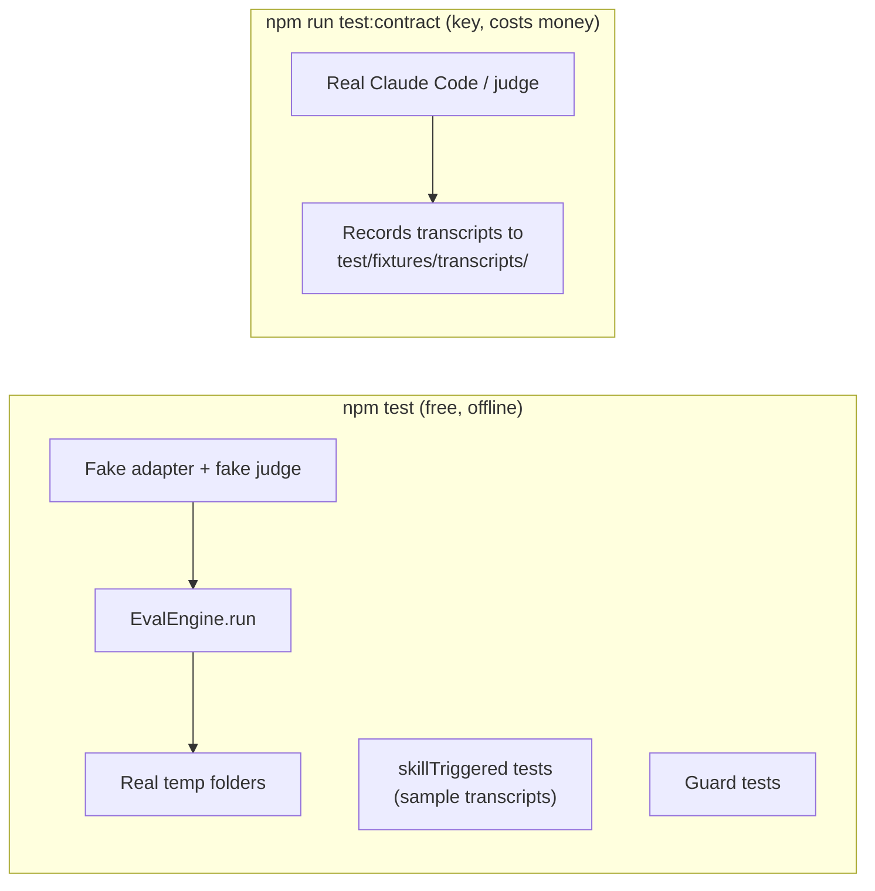

# io-intelligence skill evals

A small local eval engine for the [`io-intelligence`](../skills/io-intelligence/SKILL.md) skill. It asks Claude Code questions with the **working copy** of the skill installed and checks whether:

- the skill **loads** for the question;
- the answer **contains** (or avoids) specific text, such as package names;
- the answer meets a **rubric**, as graded line by line by a judge model.

Each case runs once. The results are compared with a committed `baseline.json`, so you can see what a skill edit changed.

Design background: [docs/specs/io-intelligence-eval-engine-lite.md](../docs/specs/io-intelligence-eval-engine-lite.md).

---

## Quick start

```bash
cd evals
npm install
cp .env.example .env          # add ANTHROPIC_API_KEY
# write cases in evals/cases/<id>.yaml (see "Writing cases")
npm run eval                  # run every case
npm run eval -- --case my-id  # run one case
npm run eval:approve          # make the latest run the baseline, then commit baseline.json
```

`ANTHROPIC_API_KEY` is used by both Claude Code and the judge. If it's missing, the run stops before anything starts.

---

## Writing cases

A case is a YAML file anywhere under `evals/cases/`:

```yaml
id: mcp-web-for-browser-apps # required, unique, kebab-case
prompt: Which package exposes MCP tools from an io.Connect browser app to io.Assist? # required
mustInclude: ["@interopio/mcp-web"] # optional
mustNotInclude: ["/@interopio\\/mcp-(server|browser)/"] # optional: invented package names
rubric: | # optional
  - Recommends @interopio/mcp-web for a browser app
  - Explains that io.Assist discovers the registered tools
  - Does not invent APIs
```

| Field | Required | Meaning |
|---|---|---|
| `id` | ✅ | Unique, kebab-case. Also the transcript file name. |
| `prompt` | ✅ | The single message sent to Claude Code. |
| `mustInclude` | | Matchers that must all appear in the final answer. |
| `mustNotInclude` | | Matchers that must not appear in the final answer. |
| `rubric` | | One requirement per line, graded by the judge. |

**Matchers:** a plain string is a case-sensitive substring, and `/pattern/flags` is a regex (the `g` and `y` flags are ignored).

Cases are validated with Zod when a run starts. Any other field is an error, as are a missing `prompt`, an invalid regex and a duplicate `id`. The error names the file and the field. This includes fields from the old engine, such as `kind`, `targets`, `repeat`, `passThreshold` and `flow`.

Every run uses the same limits: 15 turns and 3 minutes.

---

## How a case runs



1. **Workspace.** The engine creates a fresh temp folder `iointel-eval-*/work` and copies `skills/io-intelligence` into `.claude/skills/io-intelligence`, which is where Claude Code discovers project skills.
2. **Agent.** The adapter calls the Agent SDK's `query()`:
   - `cwd` is the temp folder.
   - `settingSources: ["project"]` and `skills: "all"`: Claude Code loads only the skill in the temp folder, with none of your user skills, plugins, `CLAUDE.md` or MCP servers.
   - The model is `--model`, or `claude-sonnet-5-5` by default.
   - A `canUseTool` guard denies file access and commands that point outside the temp folder.
   - A timer aborts the run after 3 minutes.

   It collects every SDK message. The final `result` message supplies the answer text, the turn count and the cost. The skill counts as **triggered** when the transcript contains a `Skill` tool call naming the skill, or a `Read` of its `SKILL.md`. The skill name is the last segment of the install path, so it can't drift from where the skill is copied.
3. **Checks**, in order, stopping at the first failure:
   1. **agent finished:** no error, no turn limit, no timeout;
   2. **skill triggered:** a right answer from the model's prior knowledge alone doesn't count;
   3. **`mustInclude` / `mustNotInclude`:** checked against the final message.
4. **Judge:** only when every check passed and the case has a non-empty rubric (see below).
5. The case **passes** when every check passes and every rubric line passes.

Web access is on: the skill can fall back to the online docs, as it does in real use.

> The guard catches mistakes, not attacks. It's a heuristic over tool inputs, not an OS sandbox. That's enough for running your own cases against your own skill.

---

## The rubric and the judge

The adapter never sees the rubric. After the agent has finished and the cheap checks have passed, a second model, **Claude Opus 5.5** with medium effort, grades the answer.

**1. The rubric is split into lines.** Each non-empty line is one criterion, and list markers (`-`, `*`, `1.`) are removed:

```
0. Recommends @interopio/mcp-web for a browser app
1. Explains that io.Assist discovers the registered tools
2. Does not invent APIs
```

**2. The judge gets one message:**

```
<rubric>
0. Recommends @interopio/mcp-web for a browser app
1. Explains that io.Assist discovers the registered tools
2. Does not invent APIs
</rubric>

<final_message>
…the agent's answer…
</final_message>

<transcript>
…every SDK message as JSON: which skill files it read, which tools it called…
</transcript>

Return one verdict per rubric line, using the line numbers above as "index".
```

Its fixed system prompt tells it to grade each line independently, to pass a line only when the evidence clearly satisfies it, and to give no credit for intent or for claims the transcript contradicts.

**3. The judge returns structured JSON.** The schema is enforced, so it can't answer in free text:

```json
{ "lines": [
  { "index": 0, "pass": true,  "reason": "Final message recommends @interopio/mcp-web." },
  { "index": 1, "pass": true,  "reason": "Says io.Assist lists tools registered via mcp-web." },
  { "index": 2, "pass": false, "reason": "Mentions registerToolSync(), which appears in no skill reference it read." }
]}
```

**4. Verdict.** Any failed line fails the case. The console shows the first failed line and its reason, and `transcripts/<id>.json` keeps every line's verdict.

**Why the judge gets the transcript.** Some lines can only be checked against what the agent did, not what it wrote. "Does not invent APIs" is one: the judge can see which reference files were read and whether the API is in them.

**Edge cases:**
- A line the judge returned no verdict for counts as failed.
- A refusal or API error fails the case with a `judge` check. The agent's answer and cost are kept.
- A transcript longer than 1.5M characters is cut off and marked `truncated="true"`.
- The judge's cost (at Opus 5.5 prices) is added to the case's cost.

**Writing good rubric lines:** make each line one claim the judge can check against the answer or the transcript.

| Good | Weak | Why |
|---|---|---|
| Recommends `@interopio/mcp-web` | Gives a good answer | The weak line is vague, so the verdict is arbitrary |
| Says the tool must be registered before io.Assist connects | Explains registration and discovery and lifecycle | Three claims in one line: one failure hides which |
| Does not suggest `@interopio/mcp-http` for a browser app | — | Negative claims work well |

Put exact strings, such as package names, in `mustInclude` / `mustNotInclude` instead. Those checks are free and give the same result every time.

---

## Baseline and comparison



"Baseline" means only the committed `evals/baseline.json`:

```json
{
  "version": 2,
  "runId": "2026-11-02T10-00-00-000Z",
  "approvedAt": "2026-11-02T10:05:00.000Z",
  "entries": [{ "caseId": "mcp-web-for-browser-apps", "pass": true, "costUsd": 0.14 }]
}
```

- **Approving.** `npm run eval:approve` writes it from the latest run's `summary.json`, and `-- --run <id>` picks an earlier run. Commit the file to share it, so moving the baseline is a deliberate step that shows up in review. Approve refuses a run with no cases, and a run where any case never reached the agent (for example, the skill folder couldn't be copied), so setup failures can't be recorded as skill failures.
- **Version.** The file is version 2. A `baseline.json` written by the older, larger engine stops the run before any case starts. Delete it and approve a fresh run.
- **Comparing.** Every run is compared with it by case id:
  - **regressed:** passed before, fails now;
  - **improved:** failed before, passes now;
  - **new:** not in the baseline;
  - **removed:** in the baseline but no longer a case;
  - **unchanged:** same result as before.
- **No baseline.** Without `baseline.json` there's no comparison. Earlier local runs are never used as a reference.
- **`--case` runs** cover only part of the suite. They don't report other cases as removed, and approving one **merges** its entries into the existing baseline instead of replacing it.

---

## Output

```
evals/results/<run-id>/       (gitignored)
├── summary.json              the full Evals.Report.RunReport
└── transcripts/
    └── <id>.json             final message, judge verdicts per line, raw SDK transcript
```

Console summary:

```
case                      result  cost   notes
------------------------  ------  -----  ------------------------------------------------
mcp-web-for-browser-apps  PASS    $0.14
mcp-web-wrong-package     FAIL    $0.09  mustNotInclude /@interopio\/mcp-server/: found in the final message

Cases: 1 passed, 1 failed · cost: $0.23
Compared with baseline (2026-11-02T10-00-00-000Z):
  REGRESSED mcp-web-wrong-package
Results: …/evals/results/2026-11-04T09-00-00-000Z
```

`notes` shows one of these, in order:
- `not run: …` when the case never reached the agent;
- otherwise the first failed check;
- otherwise the first failed rubric line, with the judge's reason.

A case that never ran costs $0.

If the judge answered but its answer couldn't be used (a refusal, or no parseable verdict), the case fails and the judge's cost is still counted. If a transcript file can't be written, the case keeps its result and a warning is printed.

The process exits **0** whenever the run completed, whatever the results. It exits **1** only when a run can't start: invalid cases, a missing key or a bad flag.

---

## Command reference

```
npm run eval -- [options]
  --case ID           only this case
  --model ID          Claude model to run cases on (default claude-sonnet-5-5)
  --concurrency N     cases at once (default 4)

npm run eval:approve -- [--run ID]   promote the latest (or given) run to baseline.json
npm test                             engine tests (no network, no keys, no cost)
npm run test:contract                real Claude Code and judge (needs a key; costs money)
npm run typecheck                    tsc, plus a separate check of shared/contracts.d.ts
npm run format                       prettier
```

---

## Code layout

```
evals/
├── cases/                    your YAML cases
├── baseline.json             approved reference (committed, once you approve a run)
├── src/
│   ├── cli.ts                argument parsing; wires the real adapter, judge and workspace into an EvalEngine
│   ├── shared/
│   │   ├── contracts.d.ts    the Evals namespace: every type shared between modules
│   │   └── types.ts          every other type (used by one module)
│   ├── engine/
│   │   ├── index.ts          public entry: EvalEngine, EvalSetupError, Evals
│   │   ├── eval-engine.ts    EvalEngine.run(): select → preflight → run cases → compare → write
│   │   ├── planning.ts       load cases and apply --case
│   │   ├── preflight.ts      fail fast when the adapter or judge isn't ready
│   │   ├── case-runner.ts    CaseRunner: one case in its own workspace (agent → checks → judge → report)
│   │   ├── run-checks.ts     the deterministic checks, in order
│   │   ├── grading.ts        rubric lines and the judge call
│   │   ├── records.ts        the CaseReport for a completed or failed run
│   │   ├── run-report.ts     assembles the RunReport (options echo, totals)
│   │   ├── results-writer.ts ResultsWriter: transcripts/ and summary.json
│   │   ├── pool.ts           bounded-concurrency pool
│   │   ├── defaults.ts       concurrency, turn and time limits
│   │   └── errors.ts         EvalSetupError
│   ├── cases/                schema.ts (Zod, checked against Evals.Cases at compile time), loader.ts
│   ├── adapters/             claude-code.ts, claude-guard.ts, skill-trigger.ts
│   ├── checks/               matcher.ts, checks.ts
│   ├── judge/                anthropic-judge.ts
│   ├── workspace/            workspace.ts (temp folder + skill copy)
│   └── report/               baseline.ts, console.ts
└── test/
    ├── engine-*.test.ts      engine behaviour through EvalEngine.run with a fake adapter and judge
    ├── skill-trigger.test.ts trigger detection over sample SDK transcripts
    ├── claude-guard.test.ts  containment rules
    └── contract/             opt-in tests against the real Claude Code and judge
```

### Contracts and types

- **Every** type shared between modules is in the `Evals` namespace in `shared/contracts.d.ts`. Every other type is in `shared/types.ts`.
- `contracts.d.ts` has no JavaScript behind it, so always import it with `import type`.
- `npm run typecheck` checks `contracts.d.ts` on its own (`tsconfig.contracts.json`), because the main config's `skipLibCheck` would otherwise skip it.
- The Zod case schema and `Evals.Cases.Case` must match exactly, or the code doesn't compile.

### Design conventions

- **Singletons:** `ClaudeCodeAdapter` and `AnthropicJudge` hold no per-run state, so they have a private constructor and `getInstance()`. `TempWorkspaceManager` isn't a singleton, because each instance is bound to a skill folder.
- **Explicit visibility:** every class member is `public`, `private` or `readonly`.
- **Immutable data:** contracts are `readonly` throughout.

---

## How the tests are set up



There are two vitest configs:

- **`npm test` → `vitest.config.ts`.** Runs `test/**/*.test.ts` except `test/contract/`, with a 60s timeout. It doesn't load `.env`, so it needs no keys and costs nothing.
  - `test/helpers.ts` `makeEnv()` builds a sandbox in a temp folder: `cases/`, `results/`, a `baseline.json` path and a fake `skill/SKILL.md`.
  - `env.deps({ adapter, judge })` wires a real `TempWorkspaceManager` over that fake skill, plus a fake clock so run IDs sort in call order.
  - `fakeAdapter(script)` returns a scripted `RunResult` for each call and records its inputs. By default the skill triggered, the answer is empty and the cost is $0.10.
  - `fakeJudge(failing)` passes every line except those `failing` matches, and records what it was asked.
  - Tests write YAML cases with `env.writeCase()`, run the engine through `runEval()` (the one seam), and check the returned report and the files it wrote. They never test internal functions.
- **`npm run test:contract` → `vitest.contract.config.ts`.** Runs only `test/contract/`, with a 10-minute timeout, and loads `.env` with `setupFiles: ["dotenv/config"]`. It drives the real Claude Code and judge, and skips itself when `ANTHROPIC_API_KEY` is missing. Recorded transcripts land in `test/fixtures/transcripts/` and can become test data.

`skillTriggered()` and the guard are tested directly, because the fake adapter bypasses them.

---

## Known limitations

- **Single-turn only.** The agent can ask questions, but nobody answers them. Write prompts with enough context.
- **One run per case.** Model output varies, so a single failure can be noise. Rerun the case with `--case` before treating it as a regression.
- **Network-dependent answers** depend on docs-ai.interop.io being reachable. Check the transcript before treating a network-shaped failure as a skill regression.
