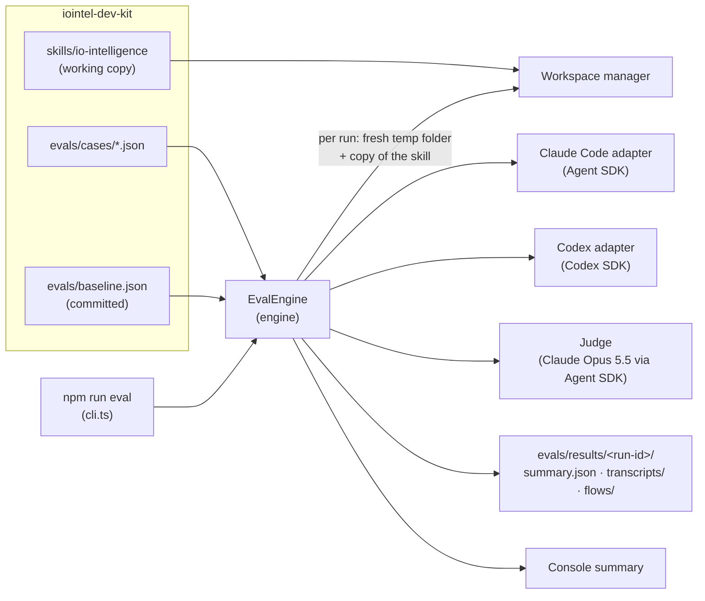
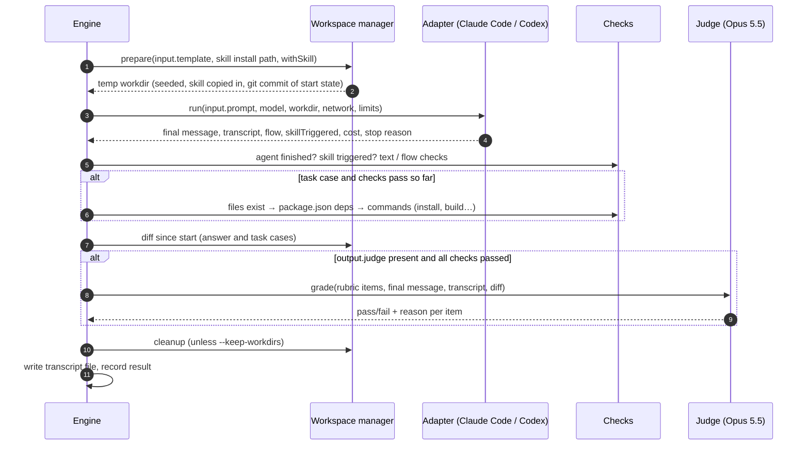
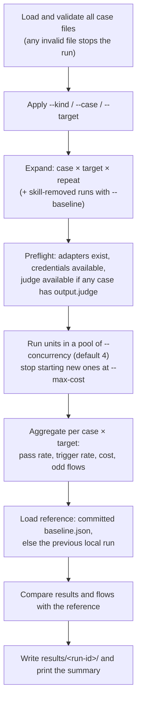
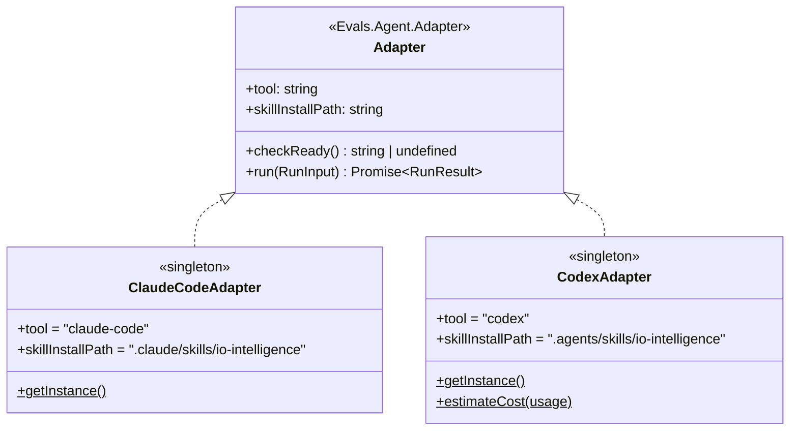
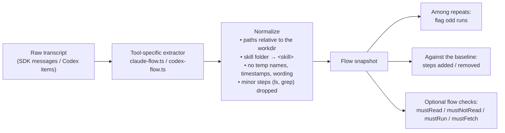
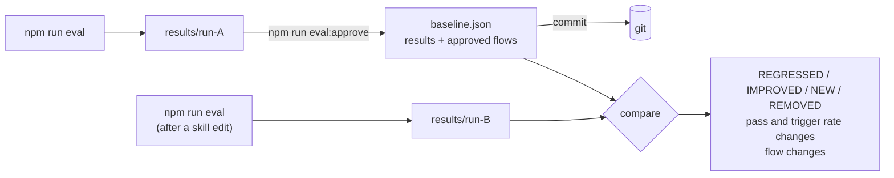
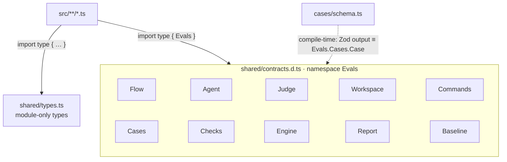
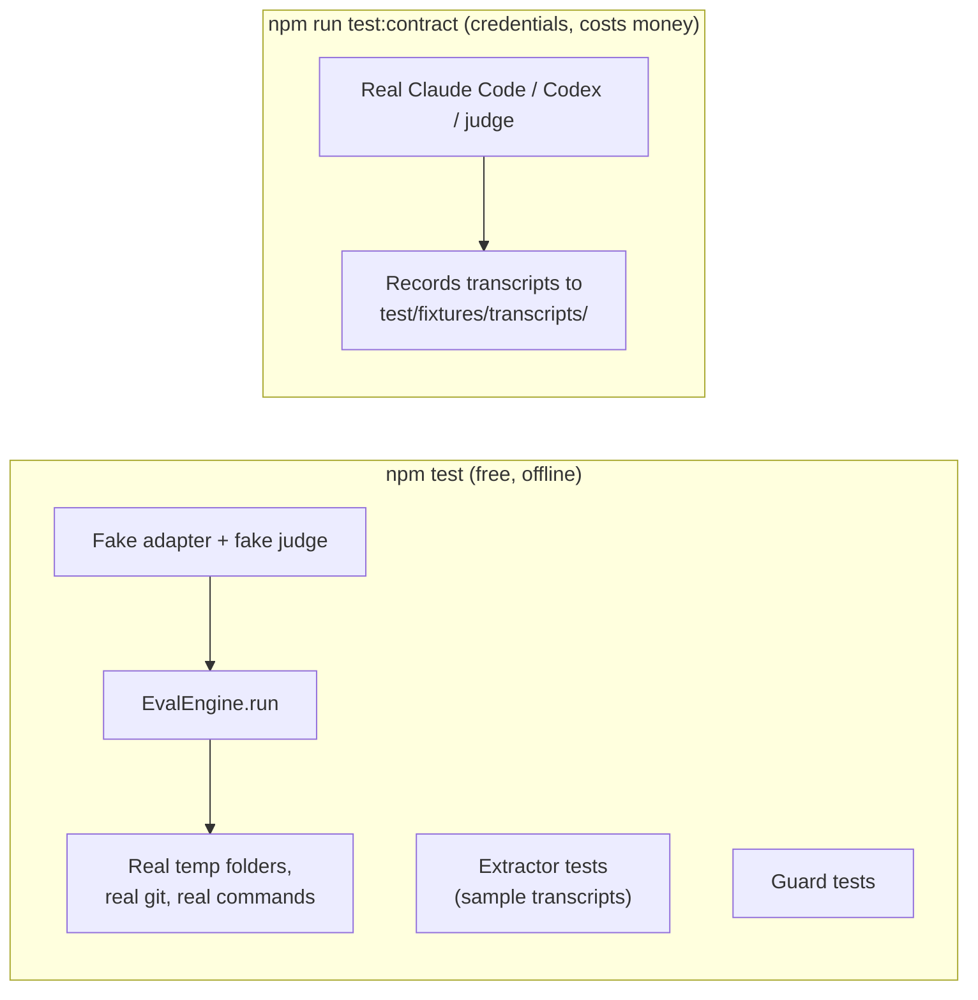

# io-intelligence skill evals

A local eval engine for the [`io-intelligence`](../skills/io-intelligence/SKILL.md) skill. It runs JSON test cases against the **working copy** of the skill, through the agent tools developers actually use, and reports whether the skill:

- **triggers**: loads for prompts that need it, and stays out of prompts that don't;
- **answers correctly**: right packages and APIs, no invented ones;
- **completes tasks**: scaffolds or extends a project that installs, type-checks and builds.

Every result belongs to a **target**, which is an agent tool and a model together (for example `claude-code/claude-sonnet-5-5` or `codex/gpt-5.5`), never a model on its own. The same skill can behave differently in different tools.

Design background: [docs/specs/io-intelligence-eval-engine.md](../docs/specs/io-intelligence-eval-engine.md).

---

## Quick start

```bash
cd evals
npm install
cp .env.example .env          # optional for Claude (see below); add OPENAI_API_KEY for Codex
# write cases in evals/cases/<kind>/<id>.json (see "Writing cases")
npm run eval -- --kind trigger --repeat 1   # a quick first run
npm run eval                                # the full suite
npm run eval:approve                        # make the latest run the baseline, then commit baseline.json
```

| Key | Needed for |
|---|---|
| `ANTHROPIC_API_KEY` or `CLAUDE_CODE_OAUTH_TOKEN` | optional: `claude-code/*` targets and the judge. Without either, they use your local Claude Code login |
| `OPENAI_API_KEY` | `codex/*` targets |
| `CODEX_PRICE_*` | optional: lets Codex runs count towards cost totals and `--max-cost` |

**Claude without an API key.** The Claude Code targets and the judge both run through the Claude Code CLI (via the Agent SDK). When neither variable is set, the CLI uses whatever Claude Code is logged into on your machine, including a Pro/Max subscription: run `claude` once and log in. `claude setup-token` prints a long-lived `CLAUDE_CODE_OAUTH_TOKEN` for the same login. A key or token in the environment always takes priority over the login. With a subscription:
- reported costs are API-price estimates, not what you pay, so `--max-cost` limits an estimate, not real spend;
- runs count against your subscription's usage limits, so lower `--concurrency` for big suites;
- it's for your own local runs only. Shared or CI setups should use an API key.

If credentials that the selected cases need are missing, the run stops before anything starts. On macOS the login lives in the Keychain and isn't checked up front; a missing login shows up as a failed run instead.

---

## How it works

### The big picture



The engine itself makes no API calls. Everything that talks to the outside world (agent tools, the judge, temp folders, shell commands) is passed to the `EvalEngine` constructor as a dependency (`new EvalEngine(deps).run(options)`). That one seam is what lets the engine be tested with fakes, and it's also where new agent tools plug in.

### One run, step by step

A case runs once per target, repeated `N` times (default 3). Each of those runs is a **run unit**:



Checks stop at the first failure, so a run that didn't trigger the skill, or whose build failed, never costs a judge call.

### From runs to a report



---

## Case kinds

All cases are JSON files under `evals/cases/` (subfolders are up to you; `cases/<kind>/<id>.json` is the convention). They're validated with Zod when a run starts. A misspelled field, a missing `targets` or an invalid regex stops the run with a message naming the file and field.

### Case shape

Every case has the same three parts: settings at the top level, `input` (what the agent gets) and `output` (what is checked afterwards).

```json
{
  "id": "code-mode-approve-payment",
  "note": "HUMAN_PROMPTS.md row 17 (question: should not change files)",
  "kind": "task",
  "targets": ["claude-code/claude-sonnet-5-5"],
  "input": {
    "prompt": "Can I make Code Mode ask me before it submits a payment?",
    "template": { "local": "io-assist-react-mcp" }
  },
  "output": {
    "deterministic": {
      "flow": {
        "mustRead": ["references/code-mode.md"],
        "mustFetch": ["docs-ai.interop.io"]
      }
    },
    "judge": {
      "rubric": [
        "Uses an asynchronous interceptors.onToolCall to pause submit_payment until it is approved",
        "Keeps server-side authorization and validation of submit_payment, beyond the approval prompt",
        "Makes no file changes: the workspace diff is empty"
      ],
      "threshold": 1
    }
  }
}
```

**Settings**

| Field | Required | Default | Meaning |
|---|---|---|---|
| `id` | ✅ | | Unique, kebab-case |
| `note` | | | Free text for humans (where the case came from, what it expects). JSON has no comments, so use this instead. Ignored by the engine |
| `kind` | ✅ | | `trigger`, `answer` or `task` |
| `targets` | ✅ | | Where the case runs: `claude-code/<model>`, `codex/<model>` |
| `network` | | `true` | `false` blocks web access, to test the bundled references alone |
| `repeat` | | 3 (or `--repeat`) | Runs per target |
| `passThreshold` | | ⅔ for trigger, 1 otherwise | Fraction of runs that must pass |
| `maxTurns` / `timeoutMs` | | 15 / 3 min (task: 40 / 10 min) | Per-run limits |

**`input`**

| Field | Required | Meaning |
|---|---|---|
| `prompt` | ✅ | The single message sent to the agent |
| `template` | | The project the agent starts in. `{ "official": "<id>" }` fetches an official template with the skill's own `materialize-template.mjs` (needs network access and Git). `{ "local": "<name>" }` copies `evals/templates/<name>`. Omitted: an empty folder |
| `reply` | | What the simulated user answers when the agent asks a question (Claude Code's `AskUserQuestion`). Every question gets this reply as free text, so it can name an option's label or say anything else, e.g. `"Use your recommended defaults."` Omitted: questions come back unanswered, and the agent usually stops to wait. Codex has no question tool, so it ignores this field |

Every run gets a fresh temp folder, seeded from the template, with the skill copied to where the tool discovers it and the starting state committed to a throwaway git repo, so the diff of what the agent changed is exact.

**`output.deterministic`**: checks with no model involved, all optional.

| Field | Kinds | Default | Meaning |
|---|---|---|---|
| `expectSkill` | all | `true` | Whether the skill should load. `false` makes a negative case |
| `flow` | all | | `mustRead` / `mustNotRead` / `mustRun` / `mustFetch` (see [Flow snapshots](#flow-snapshots)). Order doesn't matter: each checks whether the run did it at any point |
| `mustInclude` / `mustNotInclude` | answer | `[]` | Matchers checked against the final message |
| `files` | task | `[]` | Paths that must exist afterwards |
| `packageJson` | task | | `dependencies` / `devDependencies` that must be declared. `"*"` means any version; otherwise the range must match exactly |
| `commands` | task | `[]` | Run in order; the first non-zero exit fails the run |

**`output.judge`**: checks graded by the judge model (answer and task cases only).

| Field | Default | Meaning |
|---|---|---|
| `rubric` | | One expectation per item. A `[report-only]` prefix means graded and reported, but never counted |
| `threshold` | `1` | Share of counted items a run must pass |

The judge sees the final message, the transcript and the **git diff** of everything the agent changed (lockfiles and the skill folder left out).

**Matchers.** Anywhere a check takes text, a plain string is a case-sensitive substring, and `/pattern/flags` is a regex. The `g` and `y` flags are ignored.

### `trigger`: does the skill load?

```json
{
  "id": "mcp-web-tool-trigger",
  "kind": "trigger",
  "targets": ["claude-code/claude-sonnet-5-5", "codex/gpt-5.5"],
  "input": { "prompt": "I want io.Assist to call a function in my io.Connect browser app. How?" }
}
```

```json
{
  "id": "unrelated-python",
  "note": "Negative case: must NOT load the skill",
  "kind": "trigger",
  "targets": ["claude-code/claude-sonnet-5-5"],
  "input": { "prompt": "Write a Python function that reverses a string." },
  "output": { "deterministic": { "expectSkill": false } }
}
```

A run passes when the skill triggered (or didn't) as expected. The case passes at **≥ 2 of 3** runs by default, because triggering naturally varies from run to run.

### `answer`: is the answer right?

```json
{
  "id": "mcp-web-for-browser-apps",
  "kind": "answer",
  "targets": ["claude-code/claude-sonnet-5-5"],
  "input": {
    "prompt": "Which package exposes MCP tools from an io.Connect browser app to io.Assist?"
  },
  "output": {
    "deterministic": {
      "mustInclude": ["@interopio/mcp-web"],
      "mustNotInclude": ["/@interopio\\/mcp-(server|browser)/"]
    },
    "judge": {
      "rubric": [
        "Recommends @interopio/mcp-web for a browser app",
        "Explains that io.Assist discovers the registered tools",
        "Does not invent APIs",
        "[report-only] Mentions the Angular variant"
      ]
    }
  }
}
```

`mustNotInclude` here catches invented package names.

The checks run in this order, and the run fails at the first one that fails:
1. **Agent finished:** no error, no turn limit, no timeout.
2. **Skill triggered:** answer and task cases also expect the skill to load, so a right answer from the model's prior knowledge alone doesn't count.
3. **`mustInclude` / `mustNotInclude` and `flow`:** checked against the final message and the run's flow. Free, and reliable for package names.
4. **`judge`:** the judge marks each rubric item pass or fail, with a one-line reason. See [Rubric scores](#rubric-scores).

**Every** run must pass for the case to pass.

### `task`: does the result build?

```json
{
  "id": "add-mcp-tool-react",
  "kind": "task",
  "targets": ["claude-code/claude-sonnet-5-5"],
  "input": {
    "prompt": "Add an MCP tool \"getPortfolio\" to this app so io.Assist can call it.",
    "template": { "official": "io-assist-react-packaged" }
  },
  "output": {
    "deterministic": {
      "files": ["src/mcp/tools.ts"],
      "packageJson": { "dependencies": { "@interopio/mcp-web": "*" } },
      "commands": ["npm install", "npx tsc --noEmit", "npm run build"]
    },
    "judge": {
      "rubric": [
        "Registers the tool when the app starts",
        "Uses the existing io.Connect client instead of creating a new one"
      ]
    }
  }
}
```

The checks run in this order: agent finished → skill triggered → flow → files → `package.json` → commands (stopping at the first non-zero exit, and keeping the end of its output) → judge. Every run must pass.

Template build commands differ: React uses `tsc -b && vite build`, Angular packaged uses `ng build`, Angular editable has its own script, and the vanilla template has no build step. List the right `commands` for each starting point.

---

## Targets and adapters



| | Claude Code | Codex |
|---|---|---|
| Runs through | `@anthropic-ai/claude-agent-sdk` | `@openai/codex-sdk` |
| Skill installed at | `.claude/skills/io-intelligence` | `.agents/skills/io-intelligence` |
| Isolation | Loads only project settings from the temp folder: no user skills, plugins, `CLAUDE.md` or MCP servers | Runs with an empty, temporary home folder, so no user config or skills |
| Containment | A permission guard (`canUseTool`) rejects file access and commands that point outside the workdir | Codex's own `workspace-write` sandbox |
| Trigger detected by | A `Skill` tool call naming `io-intelligence` | Any command that reads `<skill>/SKILL.md` (Codex has no explicit skill event) |
| `network: false` | Removes `WebFetch`/`WebSearch` and blocks `curl`, `wget`, `iwr`, `git clone/fetch/pull` | Disables network access and web search |
| Turn limit | Enforced | Not available in Codex; only the timeout applies |
| Credentials | `ANTHROPIC_API_KEY`, `CLAUDE_CODE_OAUTH_TOKEN`, or the local Claude Code login (`claude-auth.ts`) | `OPENAI_API_KEY` |
| Cost | Reported by the SDK (an API-price estimate) | Calculated from token usage × `CODEX_PRICE_*`; otherwise "unknown" |
| Default model | `claude-sonnet-5-5` | Codex's own default |

Each run records how triggering was detected, so a Codex trigger rate isn't mistaken for the same kind of signal as Claude's.

> The Claude Code guard catches mistakes, not attacks. It's a heuristic over tool inputs, not an OS sandbox. That's enough for running your own cases against your own skill.

---

## Flow snapshots

Pass or fail tells you **what** happened. A flow snapshot tells you **how**: the ordered key steps the agent took, recorded for every run in the same format for every tool.



A snapshot looks like this:

```
1. skill-loaded io-intelligence (via skill-tool)
2. read <skill>/references/core.md
3. read <skill>/references/mcp-integration.md
4. fetch https://docs-ai.interop.io/llms.txt
5. script materialize-template --template io-assist-react-packaged --target app
6. write src/mcp/tools.ts
7. command npm run build → exit 1
8. command npm run build → exit 0
outcome: done · 23 turns · $0.41
```

Two runs that took the same route produce **identical** snapshots, whatever temp folder they ran in, so differences are meaningful:

- **Odd runs:** repeats are grouped by identical snapshots, and runs outside the largest group are flagged. For example, if two runs read `mcp-integration.md` and the third read `custom-ai-web.md`, the third is flagged, even when all three passed.
- **Baseline flow changes:** the case's usual flow is compared with the approved one, e.g. "no longer reads `core.md`" or "a build retry appeared".
- **Flow checks:** once you've found a corner case, lock it in. A violated check fails the run:

  ```json
  "flow": {
    "mustRead": ["<skill>/references/core.md", "/mcp-integration\\.md$/"],
    "mustNotRead": ["custom-ai-web.md"],
    "mustRun": ["/^npm (i|install)\\b/", "materialize-template --template io-assist-react-packaged"],
    "mustFetch": ["docs-ai.interop.io"]
  }
  ```

  `mustFetch` matches a fetched URL or web search, or a download command (curl, wget, iwr…).

Odd runs and flow changes are **reported only** and never fail a case. Flows vary between runs for legitimate reasons, so only explicit flow checks fail runs.

---

## Baseline and comparison



- Each run is compared with the **committed `baseline.json`**. Without one, it's compared with the previous local run.
- `npm run eval:approve` promotes the latest run (or `-- --run <id>`) to the baseline. Commit `baseline.json` to share it with the team. Moving the baseline is a deliberate step that shows up for review.
- **Filtered runs** (`--case`, `--kind`, `--target`) only cover part of the suite. They don't report the cases they skipped as "removed", and approving one **merges** into the baseline instead of replacing it.

### Rubric scores

The judge grades every rubric line pass or fail. Each graded run also gets a **rubric score**: the share of its lines that passed, from 0 to 1. A run that passed 3 of 4 lines scores 75%.

- **Threshold:** a run passes the judge step when its score reaches `output.judge.threshold`. It defaults to `1`, meaning every rubric item must pass. Use a lower value, e.g. `0.75`, when one miss shouldn't fail the run. Small rounding is allowed, so `0.6667` accepts 2 of 3.
- **Report-only lines:** start a line with `[report-only]` to have it graded and reported without counting towards the score or pass/fail. Use it for lines you're still tuning. The judge sees the line without the marker. A case with a failed report-only line gets a "report-only lines failed" note.
- **Per case:** the console's `rubric` column shows the mean score over the graded runs and how many were graded, e.g. `83% (3)`. Runs that failed a deterministic check never reach the judge, so they don't count. `-` means no run was graded.
- **Compared with the baseline:** score changes are listed with the other comparison changes ("rubric 50% → 100%"), but on their own they never mark a case regressed or improved.

---

## Pass rules

| | Run passes when | Case passes when |
|---|---|---|
| `trigger` | Agent finished, and the skill triggered exactly as `expectSkill` says, plus any flow checks | ≥ ⅔ of runs pass (`passThreshold` overrides) |
| `answer` | Agent finished, skill triggered, text checks pass, flow checks pass, rubric score ≥ `output.judge.threshold` (default: every item) | **every** run passes |
| `task` | Agent finished, skill triggered, files, deps, commands and flow checks pass, rubric score ≥ `output.judge.threshold` (default: every item) | **every** run passes |

- If every run of a case was skipped by the cost cap, the case shows as `SKIPPED`, not failed.
- A judge error (refusal, API failure or unparseable verdict) fails that run but keeps the agent's transcript and cost.
- The process exits **0** whenever the run completed, whatever the results; reporting is all it does for now. It exits **1** only when a run can't start: invalid cases, missing credentials, or a bad flag.

---

## Command reference

```
npm run eval -- [options]
  --kind trigger|answer|task   only cases of this kind
  --case ID                    only this case
  --target ID                  a target ("claude-code/claude-sonnet-5-5") or a whole tool ("codex")
  --repeat N                   runs per case (default 3; a case's own repeat wins)
  --concurrency N              runs at once (default 4)
  --max-cost USD               stop starting new runs once this much has been spent
  --baseline                   also run every case WITHOUT the skill, to show what it adds
  --keep-workdirs              keep temp workspaces for debugging

npm run eval:approve -- [--run ID]   promote the latest (or given) run to baseline.json
npm test                             engine tests (no network, no keys, no cost)
npm run test:contract                real adapters and judge (needs credentials; costs money or subscription usage)
npm run typecheck                    tsc, plus a separate check of shared/contracts.d.ts
npm run format                       prettier
```

**`--baseline`** reruns every unit with the skill removed and reports the difference next to each case ("without skill: pass 20%"). It answers "does the skill actually help, or did the model already know this?". Runs without the skill never affect pass or fail.

### What a run writes

```
evals/results/<run-id>/            (gitignored)
├── summary.json                   the run at a glance (Evals.Summary.File, see below)
├── transcripts/
│   └── <case>__<target>__<n>.json final message, flow, diff and raw transcript per run
├── flows/
│   └── <case>.md                  every run and target side by side, odd runs and changes highlighted
└── reports/
    └── <case>.md                  everything per case: prompt, then per run the result, checks,
                                   judge verdicts and reasons, flow, final message and diff
```

**`summary.json`** reads top-down, from the whole run to single runs:

```jsonc
{
  "version": 2,
  "run":    { "id", "startedAt", "finishedAt", "durationSec", "options", "comparedTo", "resultsPath" },
  "totals": { "verdict": "fail", "cases": { "passed", "failed", "skipped" }, "runs": { "ran", "skipped" },
              "cost": { "usd", "incomplete", "byTarget" } },
  "cases": [{
    "id", "kind", "target", "verdict": "pass" | "fail" | "skipped",
    "scores": { "pass", "trigger", "rubric" },        // shares 0..1, null when not measured
    "passThreshold", "ran", "skipped", "network", "costUsd",
    "change": { "status": "regressed", "before": { "pass", "trigger", "rubric" }, "flow": { "added": 17, "removed": 4 } },  // step counts; steps in flows/<case>.md
    "oddRuns": [2],                                      // 1-based run numbers
    "files": { "report": "reports/<case>.md", "flow": "flows/<case>.md" },
    "runs": [{
      "run": 1, "verdict", "stopReason", "turns", "costUsd",
      "trigger": { "triggered", "via" },
      "checks": { "passed", "failed", "results": [{ "name", "pass", "detail" }] },
      "judge":  { "score", "results": [{ "criterion", "pass", "reason", "reportOnly" }] },
      "files":  { "transcript", "workdir" },
      "flow":   [ /* steps, always last */ ]
    }],
    "withoutSkill": { "ran", "scores": { "pass", "trigger" }, "runs": [] }   // --baseline only
  }],
  "removed": [{ "id", "target", "before": { "pass", "trigger", "rubric" } }]   // in the reference, not in this run
}
```

Costs are rounded to 4 decimals and scores to 3. `change` is absent when there is nothing to compare with. Runs saved before this format (no `version`) are still read when they are the comparison reference.

**Start with `reports/<case>.md`** to see what happened in a case. It links each run to its transcript file for the raw events. Diffs over 20,000 characters are cut in the report; the transcript has the full diff.

The console summary:

```
case                      target                         kind     result  pass      trigger  rubric    cost   notes
mcp-web-tool-trigger      claude-code/claude-sonnet-5-5  trigger  PASS    100% (3)  100%     -         $0.21
mcp-web-tool-trigger      codex/gpt-5.5                  trigger  FAIL    33% (3)   33%      -         $0.15  odd flow, regressed
mcp-web-for-browser-apps  claude-code/claude-sonnet-5-5  answer   FAIL    67% (3)   100%     89% (3)   $0.62

Cases: 1 passed, 2 failed · runs: 9, skipped: 0 · cost: $0.98
Comparison against committed baseline (2026-11-02T10-00-00-000Z):
  REGRESSED mcp-web-tool-trigger [codex/gpt-5.5] pass 100% → 33%, trigger 100% → 33%
Odd flows among repeats (see flows/<case>.md):
  mcp-web-tool-trigger [codex/gpt-5.5]: run 2
```

---

## Code layout

```
evals/
├── cases/                    your JSON cases
├── templates/                local starting projects (input.template.local)
├── baseline.json             approved reference (committed, once you approve a run)
├── src/
│   ├── cli.ts                argument parsing, wires real adapters/judge/workspace into an EvalEngine
│   ├── shared/
│   │   ├── contracts.d.ts    the Evals namespace: every type shared between modules
│   │   └── types.ts          every other type (used by one module)
│   ├── engine/
│   │   ├── index.ts          public entry: EvalEngine, EvalSetupError, Evals
│   │   ├── eval-engine.ts    EvalEngine.run(): plan → preflight → run units → aggregate → compare → write
│   │   ├── planning.ts       load + filter cases, expand into run units (targets × repeats)
│   │   ├── preflight.ts      fail fast when an adapter or the judge isn't ready
│   │   ├── unit-runner.ts    UnitRunner: one unit in its own workspace (agent → checks → judge → record)
│   │   ├── run-checks.ts     the deterministic checks of one run, in order
│   │   ├── grading.ts        rubric lookup and the judge call
│   │   ├── records.ts        the RunRecord for a completed, failed or skipped run
│   │   ├── aggregate.ts      run records → one CaseReport per case and target
│   │   ├── run-report.ts     assembles the RunReport (options echo, totals)
│   │   ├── results-writer.ts ResultsWriter: transcripts/, summary.json, flows/, reports/
│   │   ├── pool.ts           bounded-concurrency pool
│   │   ├── defaults.ts       repeat, concurrency, thresholds, turn and time limits
│   │   └── errors.ts         EvalSetupError
│   ├── cases/                schema.ts (Zod, checked against Evals.Cases at compile time), loader.ts
│   ├── adapters/             claude-code.ts, claude-auth.ts, claude-guard.ts, codex.ts
│   ├── flow/                 normalize.ts, claude-flow.ts, codex-flow.ts, compare.ts
│   ├── checks/               matcher.ts, checks.ts, command-runner.ts
│   ├── judge/                anthropic-judge.ts (Opus 5.5 through the Agent SDK, no tools)
│   ├── workspace/            workspace.ts (temp folder + git start state + diff)
│   └── report/               summary-file.ts, baseline.ts, console.ts, flow-markdown.ts, case-markdown.ts
└── test/
    ├── engine-*.test.ts      engine behaviour through EvalEngine.run with fake adapters and judge
    ├── *-flow.test.ts        transcript → flow extraction per tool
    ├── claude-guard.test.ts  containment rules
    └── contract/             opt-in tests against the real tools and judge
```

### Contracts and types



- **Every** type shared between modules is in the `Evals` namespace. Every other type is in `shared/types.ts`. No other file declares types.
- `contracts.d.ts` has no JavaScript behind it. Always import it with `import type`; `verbatimModuleSyntax` rejects anything else.
- `npm run typecheck` checks `contracts.d.ts` on its own (`tsconfig.contracts.json`), because the main config's `skipLibCheck` would otherwise skip it.
- The case schema and `Evals.Cases.Case` must match exactly, including optional fields, or the code doesn't compile.

### Design conventions

- **Singletons:** `ClaudeCodeAdapter`, `CodexAdapter` and `AnthropicJudge` hold no per-run state, so they have a private constructor and `getInstance()`. `GitWorkspaceManager` isn't a singleton: each instance is bound to a skill folder and a local templates folder.
- **Explicit visibility:** every class member is `public`, `private` or `readonly`. Stateless helpers inside classes are `private static`. In plain modules, "private" means not exported.
- **Immutable data:** contracts are `readonly` throughout, including the arrays.

---

## Testing the engine



- Engine tests go **only through `EvalEngine.run`** (via the `runEval` helper in `test/helpers.ts`) and check the report and the files it writes. They never check internal functions.
- The extractor tests use hand-built sample transcripts. The first `npm run test:contract` saves real ones to `test/fixtures/transcripts/`, which should then become the test data.
- Contract tests skip themselves when their credentials are missing.

---

## Adding a new agent tool

1. Implement `Evals.Agent.Adapter`: `tool`, `skillInstallPath` (where that tool discovers skills), `checkReady()` and `run()`.
2. Write a flow extractor for its transcript format that produces `Evals.Flow.Step`s with the shared normalizer, plus tests against sample transcripts.
3. Register it in `cli.ts` under its tool name. Cases then use `<tool>/<model>` targets.
4. Add it to `test/contract/adapters.test.ts`.

Candidates that support skills: OpenCode (`.claude/skills` and `.agents/skills`, a native `skill` tool, any model), GitHub Copilot CLI, Gemini CLI and Goose. Cursor CLI's headless mode doesn't load skills yet.

---

## Known limitations

- **Not yet verified against real models.** The engine is tested with fakes, but the extractors and containment are only checked for real by `npm run test:contract`.
- **Runtime behaviour isn't tested.** Task cases stop at "it builds". Checking the app inside io.Connect is out of scope (templates also ship with an empty `AGENT_SERVER_URL`).
- **Single-turn only.** The agent can ask questions, but nobody answers them. Write prompts with enough context.
- **Network-dependent cases** depend on docs-ai.interop.io and GitHub being reachable. Check the transcript before treating a network-shaped failure as a skill regression.
- **Codex:** no turn limit, cost needs `CODEX_PRICE_*`, and triggering is inferred from reading `SKILL.md`.
- **`network: false`** doesn't block `npm install`.
